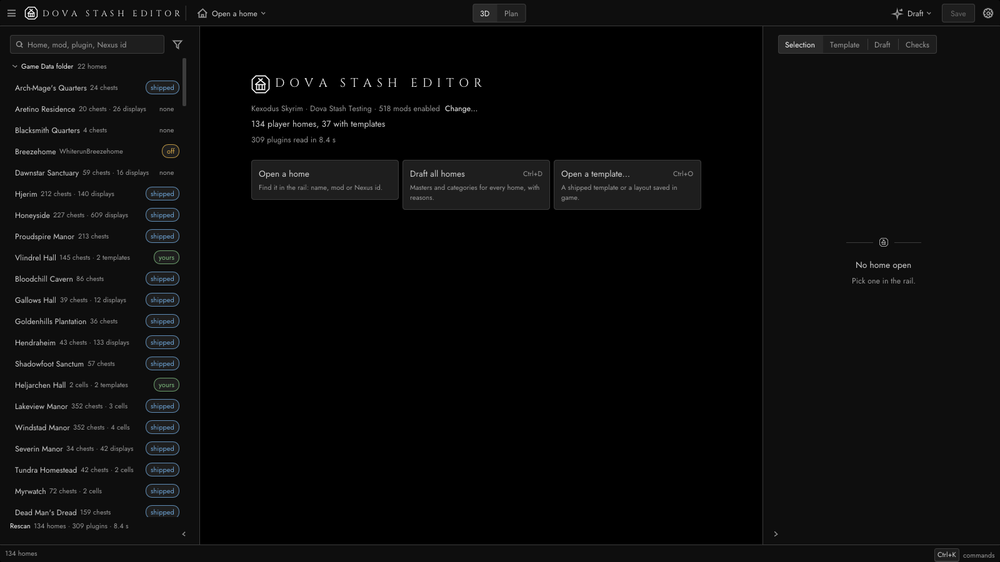
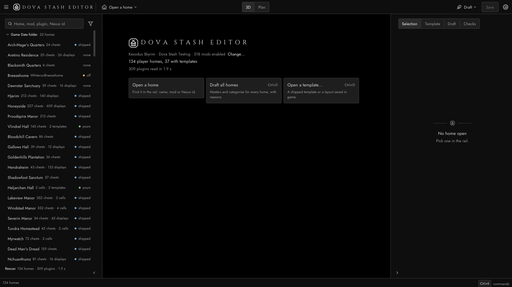
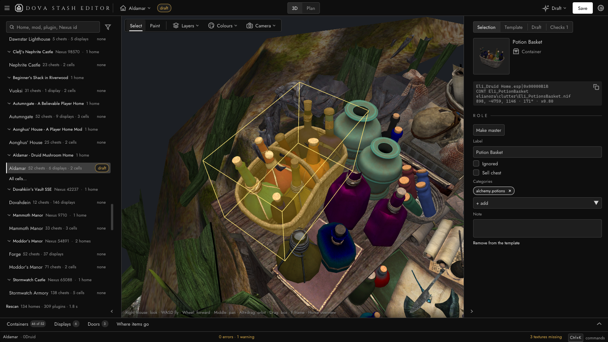
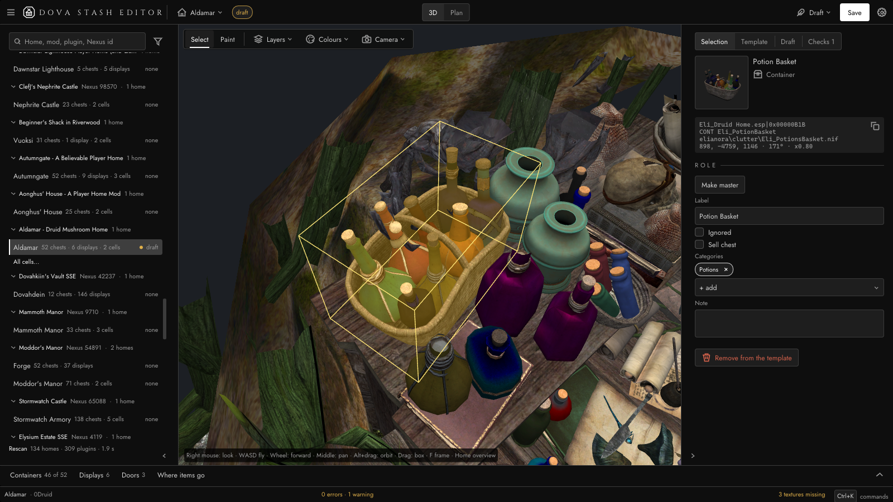
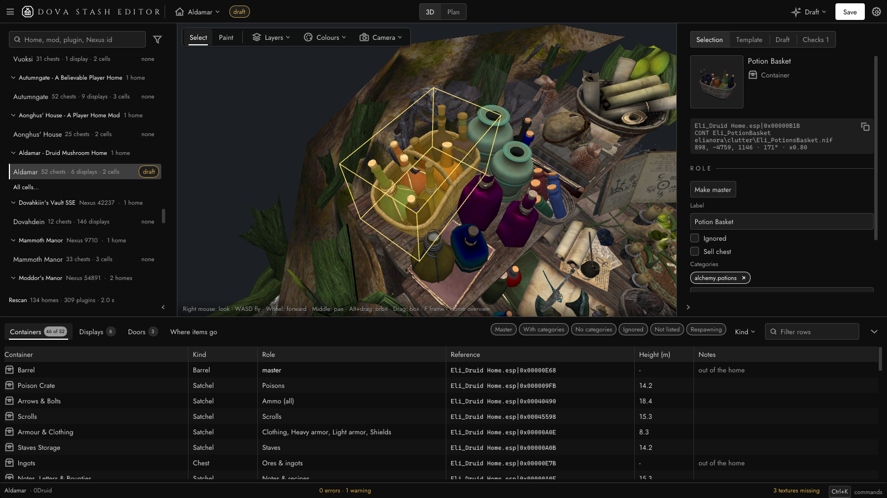
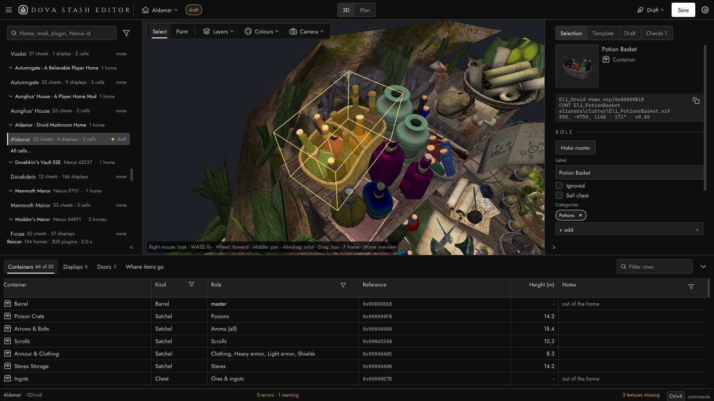
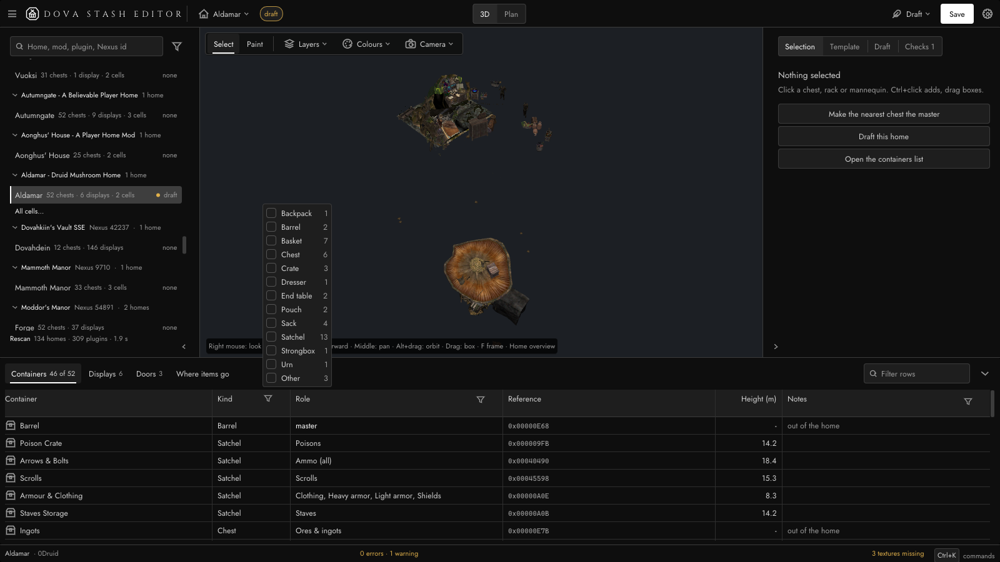
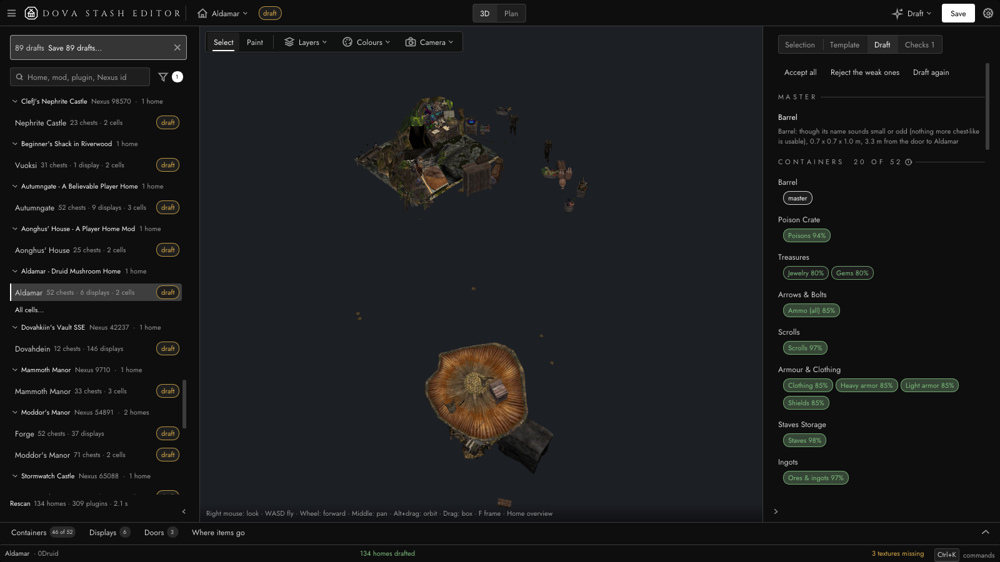
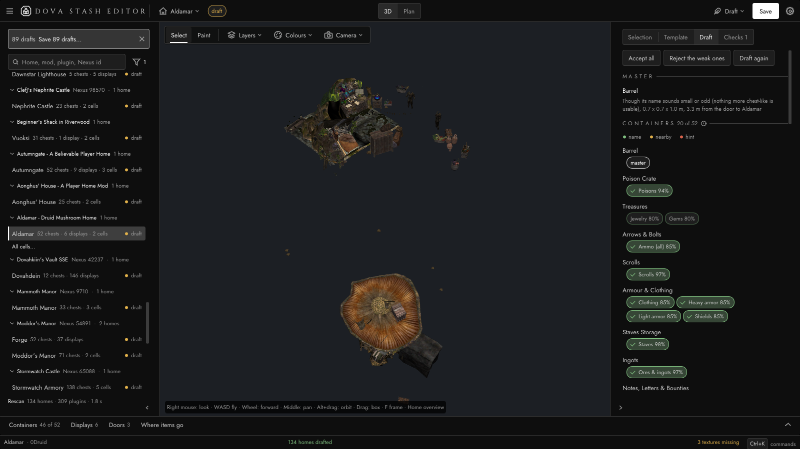

# Design pass, 2026-10-28: unslop-ui and impeccable

The editor checked against the two design skills the repo carries under `.claude/skills/` (`unslop-ui` and
`impeccable`; the rules they settled are in `docs/EDITOR-UX.md` §3.5). The window at 1600 x 900, 100 % text, taken
with `--screenshot` the way the guide's figures are (`presskit/guide/README.md`).

What changed:

- **Rail status**: a pill on every row (*shipped*, *draft*) became a 6 px dot and a muted word.
- **Counts**: the drawer tabs' filled pills (*46 of 52*, *6*, *3*) and the filter button's count became plain text.
- **Tables**: *Height (m)* and *Items* right-aligned with their headers; a hairline between rows instead of
  alternating bands.
- **Grid**: inputs 30 to 32 px, toolbar 34 to 36, title row 42 to 44, chips 22 to 24, item spacing 8/6 to 8/4.
- **Column filters**: the tab row's quick-filter chips became funnel filters in the column headers (Kind, Role,
  Notes; Kind, Used; Fill), the way a data grid filters; the tab row keeps only the count and the *Filter rows* box.
- **Design judge, round 1** (`tools/devcycle/design-judge.js`, impeccable's Assessment A plus the unslop checklist,
  7/10 before): accepted Draft suggestions show a check and the legend sits under the section head; Selection's
  category chips show names, the pattern in the tooltip; one framed `Button` for every panel action, *Remove from
  the template* alone on the last row in the error colour; dropdowns draw a chevron instead of ImGui's triangle;
  number headers sit flush right over their figures; the Reference column is muted and shows only the local id
  when a table has one plugin; the Kind filter opens upward when the table is short; the hint line gets a plate
  behind the text; the Draft icon is a quill, not a sparkle; the plan legend lists the other colours it draws;
  the plan scale bar reads in metres; a viewport floor keeps the home the hero at 1366x768 at 150 % text.
  Skipped on purpose: a gray fill ramp (status hues stay legible over 3D textures) and flattening one-home mod
  groups in the rail (the mod name is what authors scan for).

| | Before | After |
|---|---|---|
| Start panel |  |  |
| Selection |  |  |
| Containers table |  |  |
| Containers, Kind filter open | |  |
| Draft all homes |  |  |

Retake, from the repo root with the editor built (`cmake --build --preset editor-release`):

```powershell
$env:DOVASTASH_EDITOR_STATE = "$env:TEMP\ds-design-pass-state.json"
$exe = 'build\editor\editor\Release\DovaStashEditor.exe'
$mo2 = @('--mo2', 'E:\modding\Kexodus Skyrim', '--profile', 'Dova Stash Testing', '--gui', '--window', '1600x900')
$ald = @('--home', 'Aldamar')
$out = 'docs\design-pass\after'
& $exe @mo2 --screenshot "$out\start.png"
& $exe @mo2 @ald --tab 3d --select 'Eli_Druid Home.esp|0x00000B1B' --screenshot "$out\selection.png"
& $exe @mo2 @ald --tab containers --select 'Eli_Druid Home.esp|0x00000B1B' --screenshot "$out\containers.png"
& $exe @mo2 @ald --tab containers --popover kind --screenshot "$out\containers-filter.png"
& $exe @mo2 --drafts @ald --inspector draft --screenshot "$out\drafts.png"
```

Take `start.png` first with a fresh state file: the draft runs leave an *In progress* row behind.
