# Dova Stash: art gallery

Every image in `out/`, rendered with `python -I nexus/art/render.py`. Black and white, minimalist, Nordic.

## Primary image

**`keyart_1920x1080.png`** (1920×1080)

## Banner

**`banner_1920x480.png`** (1920×480)

## Features grid

**`features_grid_1200x700.png`** (1200×700)

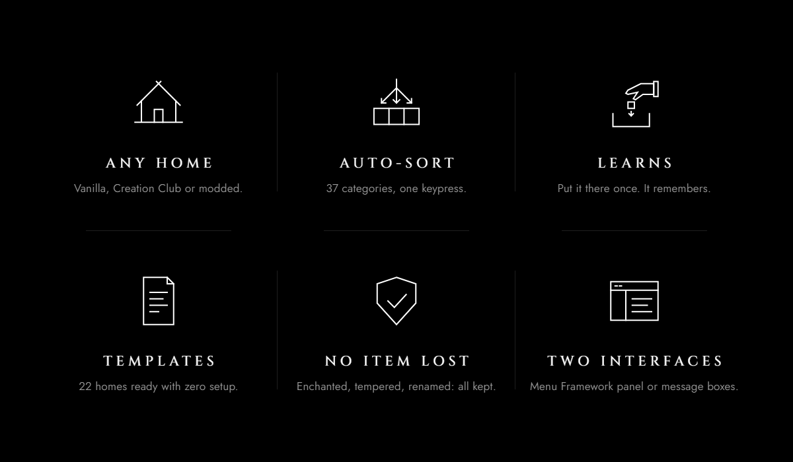

## Gallery

**`gallery_categories.png`** (1920×1080)

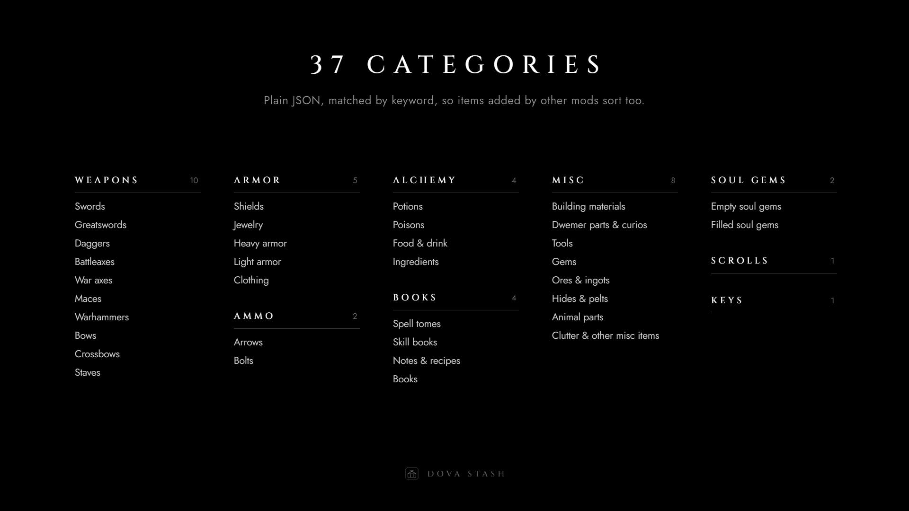

**`gallery_homes.png`** (1920×1080)

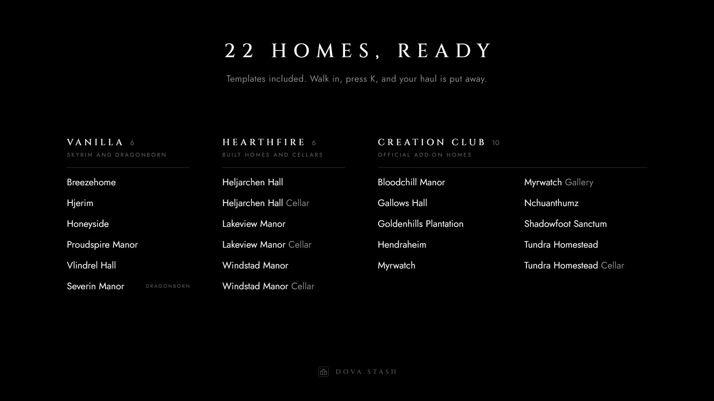

**`gallery_how_it_works.png`** (1920×1080)

**`gallery_safety.png`** (1920×1080)

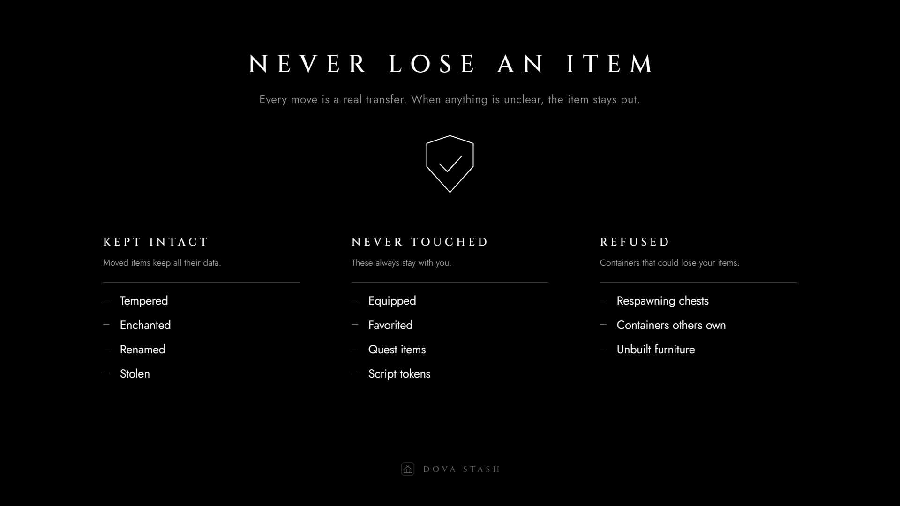

**`gallery_templates.png`** (1920×1080)

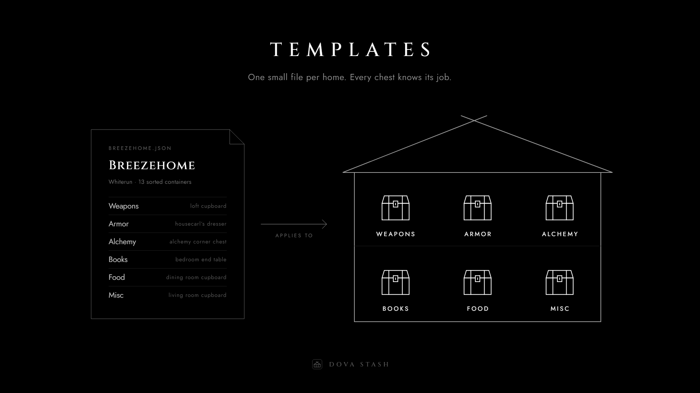

## Section headers

**`header_changelog_1200x140.png`** (1200×140)

**`header_compatibility_1200x140.png`** (1200×140)

**`header_configuration_1200x140.png`** (1200×140)

**`header_credits_1200x140.png`** (1200×140)

**`header_faq_1200x140.png`** (1200×140)

**`header_features_1200x140.png`** (1200×140)

**`header_how_it_works_1200x140.png`** (1200×140)

**`header_installation_1200x140.png`** (1200×140)

**`header_permissions_1200x140.png`** (1200×140)

**`header_requirements_1200x140.png`** (1200×140)

**`header_template_authoring_1200x140.png`** (1200×140)

**`header_templates_1200x140.png`** (1200×140)

## Divider

**`divider_1200x40.png`** (1200×40)

## Logo

**`logo_1024.png`** (1024×1024)

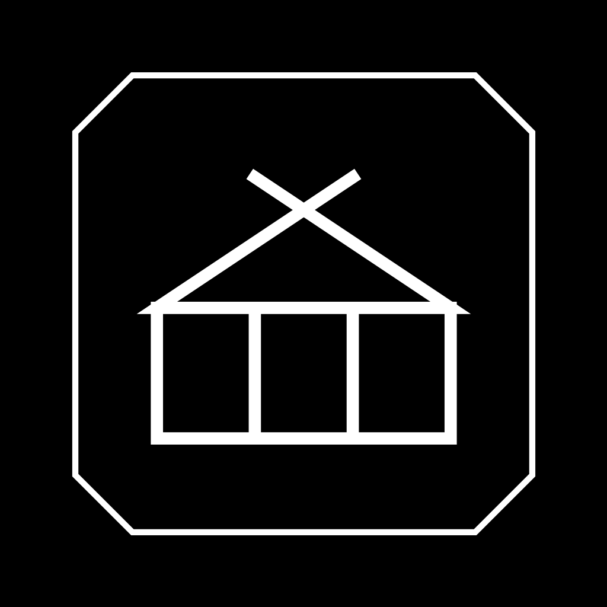

**`logo_512.png`** (512×512)

**`logo_256.png`** (256×256)

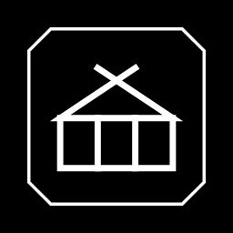

## Icons

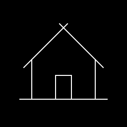 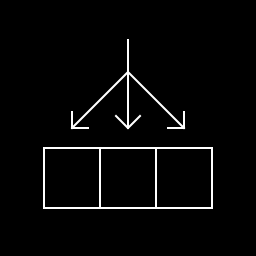 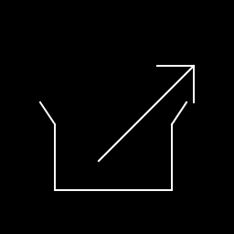  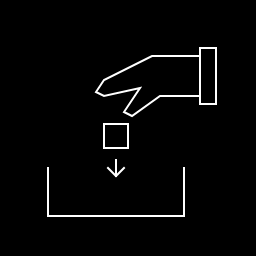  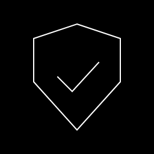 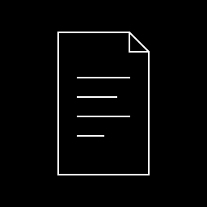 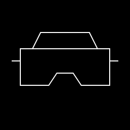

## GitHub social preview

**`github_social_1280x640.png`** (1280×640)

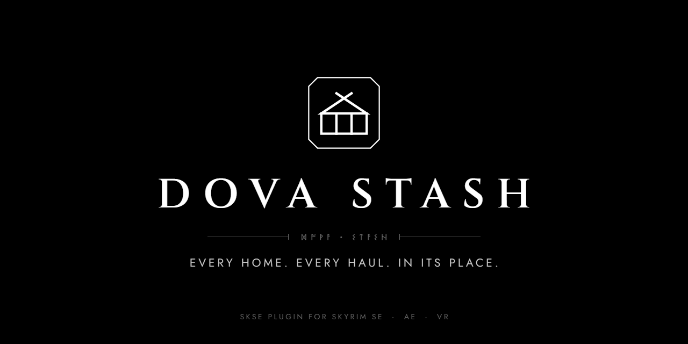

## Transparent variants

These are white on transparent and show best on a dark GitHub theme.


