# Dova Stash Press Kit

Art and copy for the **Dova Stash** Nexus page. Everything here is loose files; nothing is zipped.

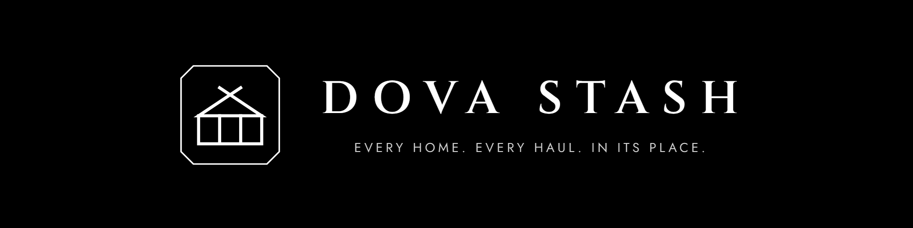

## Copy-paste text

| File | Paste into |
|---|---|
| [`nexus-description.bbcode.txt`](nexus-description.bbcode.txt) | Nexus **Description** field (BBCode). Images load from this repo's `main` branch. |
| [`nexus-summary.txt`](nexus-summary.txt) | Nexus **Brief overview** (350 characters at most) |
| [`nexus-file-description.txt`](nexus-file-description.txt) | Files tab: the main file's description |
| [`nexus-sticky-post.bbcode.txt`](nexus-sticky-post.bbcode.txt) | Posts tab: first comment, then pin it |
| [`nexus-article-templates.bbcode.txt`](nexus-article-templates.bbcode.txt) | Nexus **Articles** tab: "Making a home template" (the description links to `tools/README.md` on GitHub instead) |
| [`nexus-fields.md`](nexus-fields.md) | Every other field of the upload form: category, tags, requirements, permissions, files, image order |

The changelog is [`../CHANGELOG.md`](../CHANGELOG.md).

## Nexus page images

Upload these on the Nexus **Images** tab. Set the thumbnail as the mod's **Primary image**; Nexus uses it
for the mod tile in search and browse.

| Image | Size | Use |
|---|---|---|
| [`dovastash-thumbnail-1280x720.png`](nexus/dovastash-thumbnail-1280x720.png) | 1280×720 | **Nexus thumbnail** (set as Primary image). Emblem and name only, readable at tile size and safe under the tile's crop. |
| [`dovastash-primary-1920x1080.png`](nexus/dovastash-primary-1920x1080.png) | 1920×1080 | Gallery: emblem, name and tagline |
| [`dovastash-gallery-how-it-works-1920x1080.png`](nexus/dovastash-gallery-how-it-works-1920x1080.png) | 1920×1080 | Gallery: the three steps |
| [`dovastash-gallery-menu-1920x1080.png`](nexus/dovastash-gallery-menu-1920x1080.png) | 1920×1080 | Gallery: one key, the hotkey lists for the home, a container and a rack (their entries as the plugin shows them) |
| [`dovastash-gallery-templates-1920x1080.png`](nexus/dovastash-gallery-templates-1920x1080.png) | 1920×1080 | Gallery: a template applied to a home's chests |
| [`dovastash-gallery-homes-1920x1080.png`](nexus/dovastash-gallery-homes-1920x1080.png) | 1920×1080 | Gallery: the 22 included templates |
| [`dovastash-gallery-displays-1920x1080.png`](nexus/dovastash-gallery-displays-1920x1080.png) | 1920×1080 | Gallery: displays, mannequins and the workbench |
| [`dovastash-gallery-categories-1920x1080.png`](nexus/dovastash-gallery-categories-1920x1080.png) | 1920×1080 | Gallery: the default categories |
| [`dovastash-features-1200x700.png`](nexus/dovastash-features-1200x700.png) | 1200×700 | Gallery (optional): the six key features |
| [`dovastash-header-1920x480.png`](nexus/dovastash-header-1920x480.png) | 1920×480 | Nexus page header slot |
| [`dovastash-header-card.png`](nexus/dovastash-header-card.png) | 1976×536 | Description: the banner as a card |
| [`dovastash-how-it-works-card.png`](nexus/dovastash-how-it-works-card.png) | 1976×1136 | Description: the three steps as a card |
| [`dovastash-features-card.png`](nexus/dovastash-features-card.png) | 1244×744 | Description: the six key features as a card |
| [`dovastash-social-1280x640.png`](nexus/dovastash-social-1280x640.png) | 1280×640 | GitHub: Settings → Social preview |

<p>
  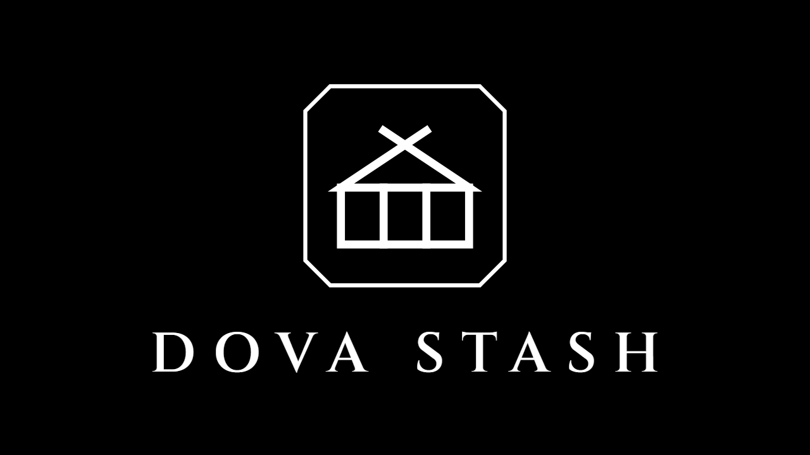
  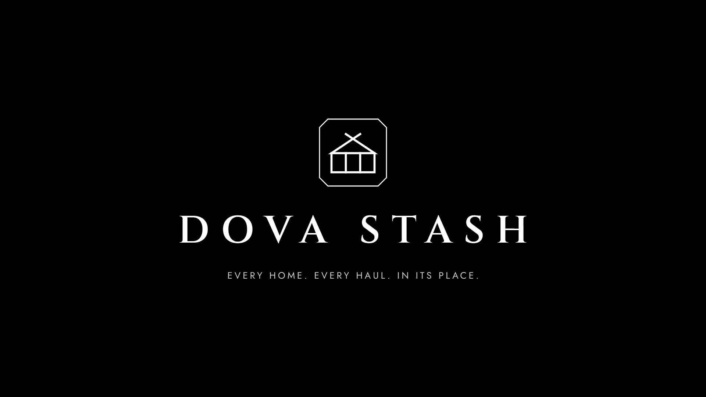
  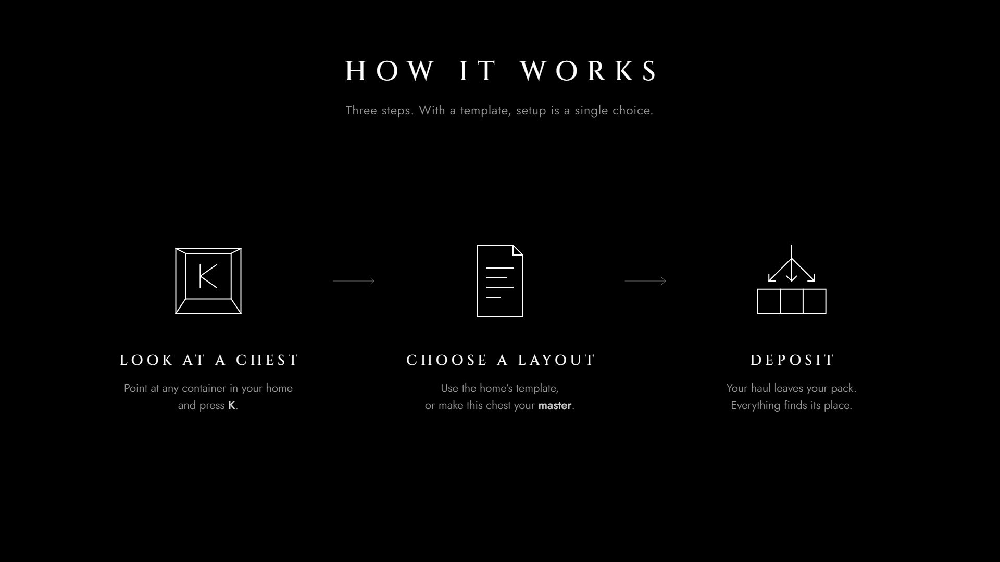
  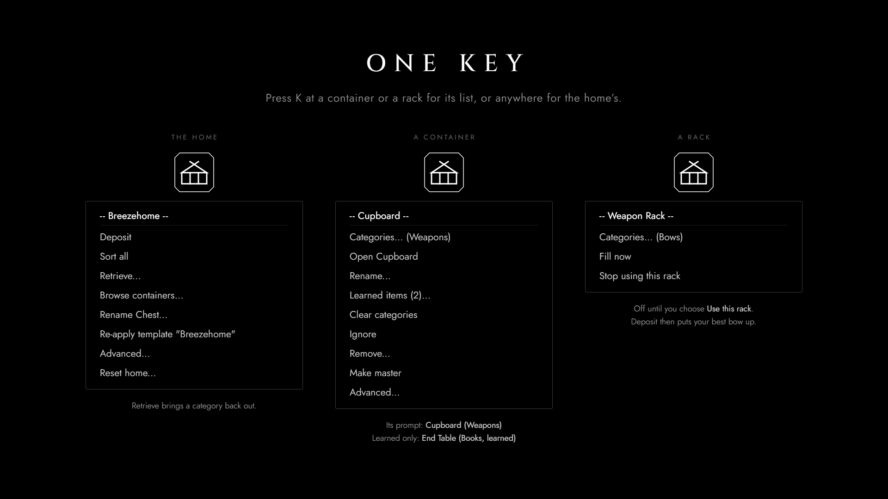
  
  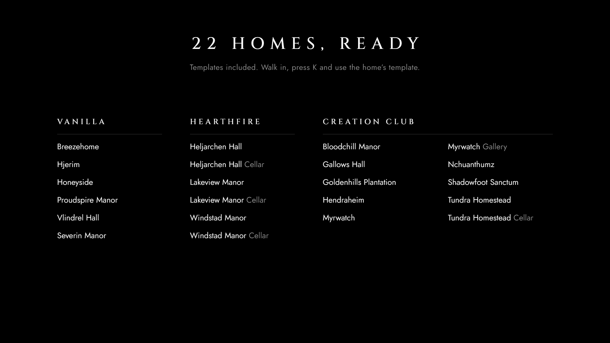
  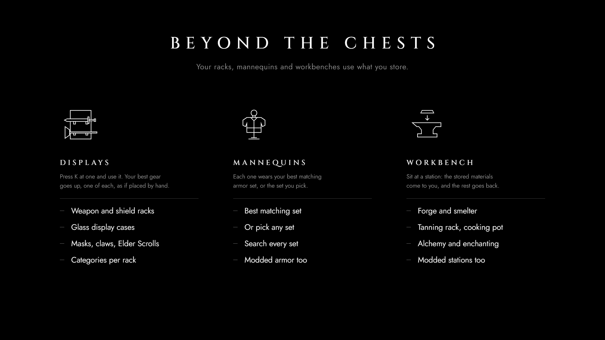
  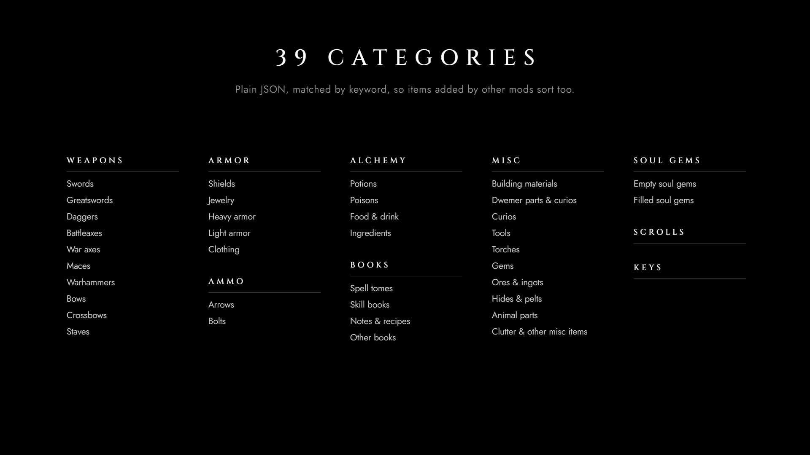
</p>

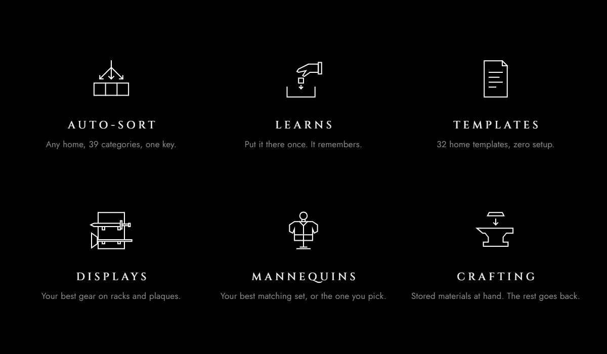

## Description section headers

The BBCode file already uses these. They are 1244×156 cards with the emblem as a left-aligned bullet, plus a 1200×40 divider: the frameless
mark as a small bullet with a hairline rule on each side, like iharvest-ng's (and a transparent
divider for non-black backgrounds).

The description follows the iharvest-ng layout: a centred intro and a `[line]` under the banner,
each header wrapped in `[center]`, bold sub-headings with lists under How it works and Installation,
and a Support section with what to put in a bug report.

Everything the description embeds is a **card**, with the same geometry as iharvest-ng's: the art keeps its full size
(1200×112, 1920×480…) as a black card with rounded corners, a hairline gray edge and a soft shadow, on a transparent
canvas that is 22 px larger on every side (28 px for 1920-wide art). It sits on the Nexus page's gray instead of as a
hard black box. `frame()` in `render.py` sets this up; any page renders as a card with `?frame=<margin>`.


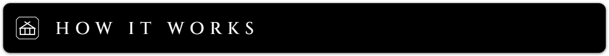
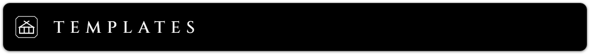

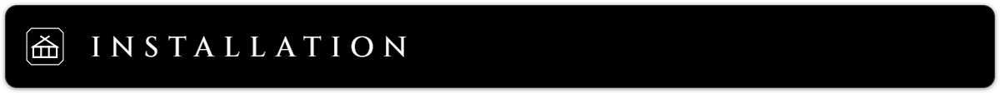
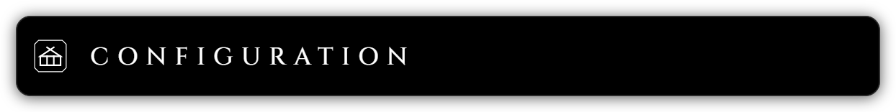
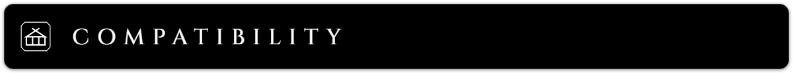
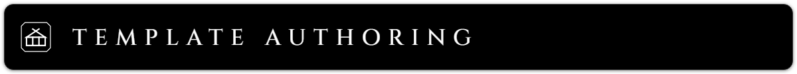
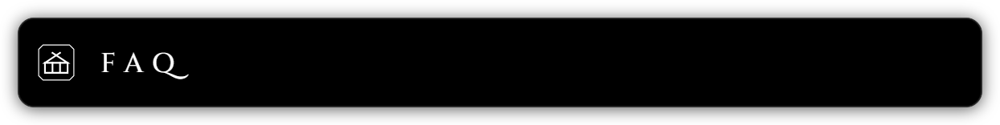
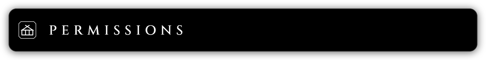
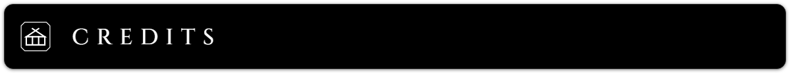

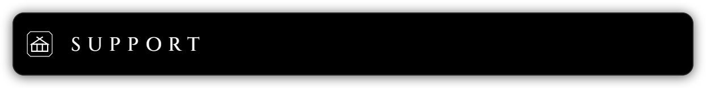


## Feature icons

256×256, a 2 px stroke. Show them at 256 or 128 px, never smaller. Not used on the page right now
(the features image covers them). They're here for a README, articles or a later description.

<p>
   
   
   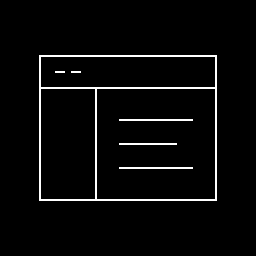
   
  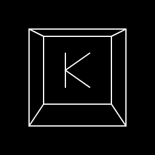 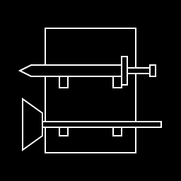
  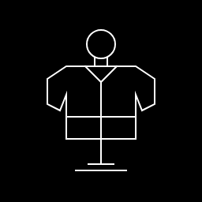 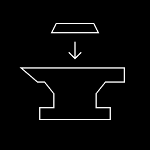
</p>

## Logo files

| File | Notes |
|---|---|
| [`logo/dovastash-logo-1024.png`](logo/dovastash-logo-1024.png) | Emblem on black |
| [`logo/dovastash-logo-512.png`](logo/dovastash-logo-512.png), [`logo/dovastash-logo-256.png`](logo/dovastash-logo-256.png) | Avatar / icon sizes (256 has heavier strokes) |
| [`logo/dovastash-logo-transparent.png`](logo/dovastash-logo-transparent.png) | White emblem, transparent background |

The transparent file is light artwork. Place it only on dark backgrounds.

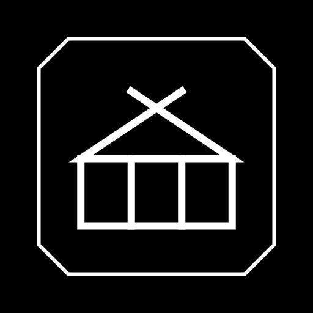

## In-game reference screenshots

Real captures (Nordic UI, QuickLoot IE, SKSE Menu Framework) to base future press kit art on.
They aren't uploaded to Nexus as they are.

| File | Shows |
|---|---|
| [`reference/ingame-quickloot-master.jpg`](reference/ingame-quickloot-master.jpg) | QuickLoot IE on the master: the container's custom name as the title, "Master" bottom-right, the **Stash** button. The floating "All" icon is on the chest. |
| [`reference/ingame-quickloot-category-icons.jpg`](reference/ingame-quickloot-category-icons.jpg) | QuickLoot IE on a bound container: the category icon row bottom-right ("icon icon icon +7"). The floating sword icon is above the chest. |
| [`reference/ingame-floating-icons-room.jpg`](reference/ingame-floating-icons-room.jpg) | A whole room with the floating category icons above managed containers. |

<p>
  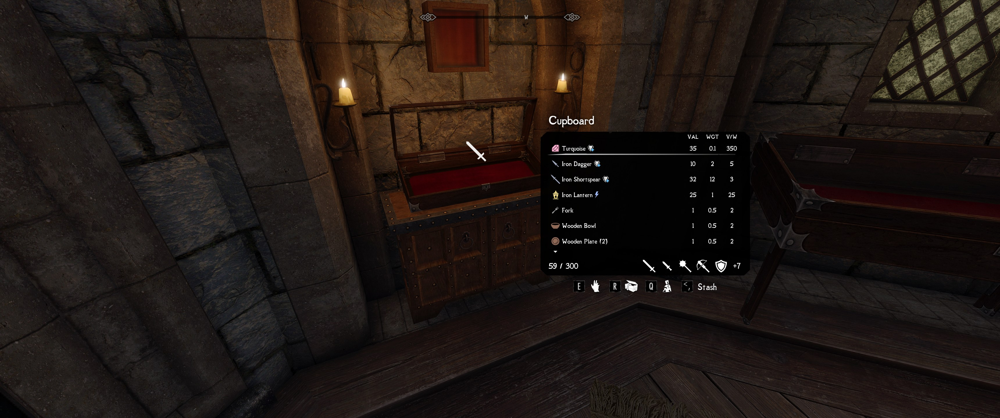
  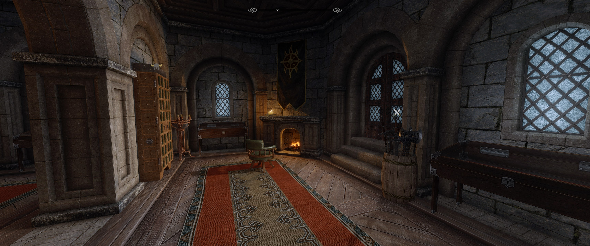
</p>

## In-game examples

The reference screenshots with the art set laid over them: the emblem and wordmark top left, a
Cinzel title and Jost caption on a bottom shade, and each feature marked with corner brackets, a
hairline leader and a black label chip. A mock-up of how press art could highlight what the
screenshots show; not in the Nexus image order yet.

| Image | Size | Highlights |
|---|---|---|
| [`dovastash-ingame-master-1920x1080.png`](in-game-examples/dovastash-ingame-master-1920x1080.png) | 1920×1080 | The master: custom name, its floating icon, "Master" in QuickLoot IE, the **Stash** button |
| [`dovastash-ingame-categories-1920x1080.png`](in-game-examples/dovastash-ingame-categories-1920x1080.png) | 1920×1080 | A bound container: the category icon row and its floating icon (captured before floating icons showed the whole row: recapture) |
| [`dovastash-ingame-room-1920x1080.png`](in-game-examples/dovastash-ingame-room-1920x1080.png) | 1920×1080 | Floating icons above the wardrobe and the weapon barrel (single icons, from before the icon rows: recapture) |

<p>
  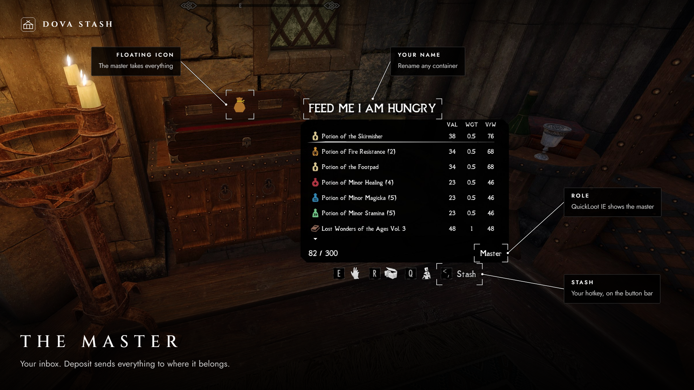
  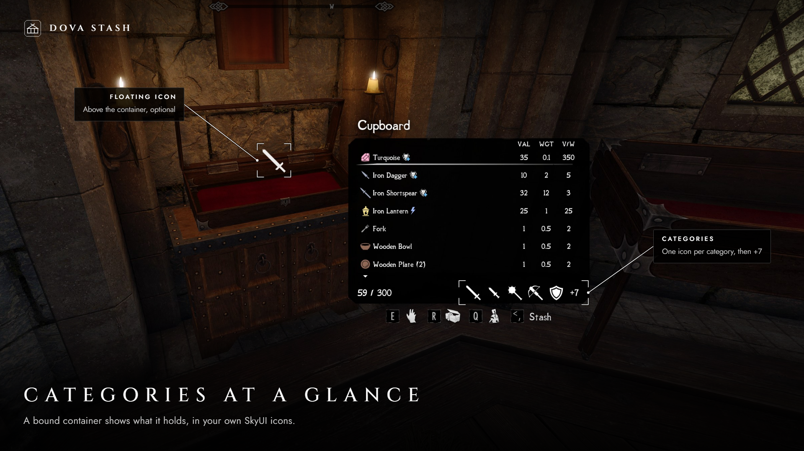
  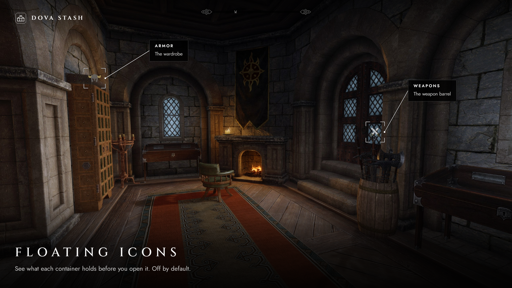
</p>

Crops, copy and callout positions are in `SHOTS` in `src/ingame.html` (boxes in the 3440×1440
source pixels, labels in output pixels). They are in color, so `--check-gray` skips them and the
size cap is Nexus's 8 MB instead of 1.5 MB. The overlay itself keeps to the palette below.

## Style

| Token | Value | Use |
|---|---|---|
| Background | `#000000` | Every canvas (description cards: a black card on a transparent canvas) |
| Card edge | `#343434` outside, `#212121` inside, 1 px each; radius = margin − 2 px | The edge around description cards |
| Foreground | `#ffffff` | Wordmark, titles, icons, emblem |
| Grays | `#d4d4d4` `#9c9c9c` `#6a6a6a` `#3c3c3c` `#1e1e1e` | Taglines, captions, quiet labels, rules, faint separators |
| Type | Cinzel (titles), Jost (text) | Wide-tracked capitals; both SIL OFL, in `src/fonts/` |

Black, white and neutral grays only: `render.py --check-gray` fails on any colored pixel. Keep it
minimal: no taglines, version tags, ornaments or game assets. The emblem (a longhouse gable over a
three-bay chest) is original and not based on any Bethesda or Skyrim logo.

## Rebuild

Requires Windows, Python 3.10 or later (standard library only), and Microsoft Edge.

```powershell
python -I presskit/src/render.py --check-gray   # every image into nexus/, logo/ and in-game-examples/, verified
python -I presskit/src/render.py section-        # only images whose name contains a filter
```

Image copy and layout live in `presskit/src/*.html`. The script regenerates `src/data.js` from
`dist/Data/SKSE/Plugins/DovaStash`, so the homes and categories galleries always match what ships.
It then screenshots each page with headless Edge and checks size, transparency and color. Change
the pages, rebuild, and commit the PNGs. Nexus loads the description images from `main`.

The artwork shares the repository license (`LICENSE`). The fonts keep their SIL Open Font License 1.1;
the license files sit next to them.
