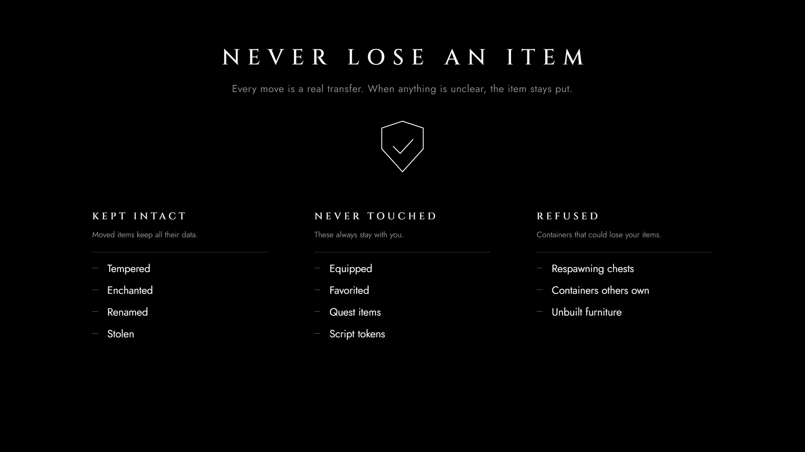

# Dova Stash Press Kit

Art and copy for the **Dova Stash** Nexus page. Everything here is loose files; nothing is zipped.


## Copy-paste text

| File | Paste into |
|---|---|
| [`nexus-description.bbcode.txt`](nexus-description.bbcode.txt) | Nexus **Description** field (BBCode). Images load from this repo's `main` branch. |
| [`nexus-summary.txt`](nexus-summary.txt) | Nexus **Brief overview** (350 characters at most) |
| [`nexus-file-description.txt`](nexus-file-description.txt) | Files tab: the main file's description |
| [`nexus-sticky-post.bbcode.txt`](nexus-sticky-post.bbcode.txt) | Posts tab: first comment, then pin it |
| [`nexus-article-templates.bbcode.txt`](nexus-article-templates.bbcode.txt) | Nexus **Articles** tab: "Making a home template" (the full guide the description links to) |
| [`nexus-fields.md`](nexus-fields.md) | Every other field of the upload form: category, tags, requirements, permissions, files, image order |

The changelog is [`../CHANGELOG.md`](../CHANGELOG.md).

## Nexus page images

Upload these on the Nexus **Images** tab. Set the thumbnail as the mod's **Primary image**; Nexus uses it
for the mod tile in search and browse.

| Image | Size | Use |
|---|---|---|
| [`dovastash-thumbnail-1280x720.png`](nexus/dovastash-thumbnail-1280x720.png) | 1280×720 | **Nexus thumbnail** (set as Primary image). Emblem and name only, readable at tile size and safe under the tile's crop. |
| [`dovastash-primary-1920x1080.png`](nexus/dovastash-primary-1920x1080.png) | 1920×1080 | Gallery: emblem, name and tagline |
| [`dovastash-gallery-how-it-works-1920x1080.png`](nexus/dovastash-gallery-how-it-works-1920x1080.png) | 1920×1080 | Gallery: the three steps |
| [`dovastash-gallery-templates-1920x1080.png`](nexus/dovastash-gallery-templates-1920x1080.png) | 1920×1080 | Gallery: a template applied to a home's chests |
| [`dovastash-gallery-homes-1920x1080.png`](nexus/dovastash-gallery-homes-1920x1080.png) | 1920×1080 | Gallery: the 22 included templates |
| [`dovastash-gallery-categories-1920x1080.png`](nexus/dovastash-gallery-categories-1920x1080.png) | 1920×1080 | Gallery: the default categories |
| [`dovastash-gallery-safety-1920x1080.png`](nexus/dovastash-gallery-safety-1920x1080.png) | 1920×1080 | Gallery: never lose an item |
| [`dovastash-features-1200x700.png`](nexus/dovastash-features-1200x700.png) | 1200×700 | Description: the six key features (optional gallery image) |
| [`dovastash-header-1920x480.png`](nexus/dovastash-header-1920x480.png) | 1920×480 | Nexus page header slot |
| [`dovastash-header-description-1920x480.png`](nexus/dovastash-header-description-1920x480.png) | 1920×480 | Description: the banner, framed |
| [`dovastash-how-it-works-description-1920x1080.png`](nexus/dovastash-how-it-works-description-1920x1080.png) | 1920×1080 | Description: the three steps, framed |
| [`dovastash-social-1280x640.png`](nexus/dovastash-social-1280x640.png) | 1280×640 | GitHub: Settings → Social preview |

<p>
  
  
  
  
  
  
  
</p>


## Description section headers

The BBCode file already uses these. They are 1200×112 with the emblem as a left-aligned bullet, plus a 1200×40 divider (and a transparent
divider for non-black backgrounds).

Everything the description embeds is **framed**: a black card with rounded corners, a hairline gray edge and a soft
shadow on a transparent canvas, so it sits on the Nexus page's gray instead of as a hard black box. Any page
renders framed with `?frame=1` (see `common.js`).


## Feature icons

256×256, a 2 px stroke. Show them at 256 or 128 px, never smaller. Not used on the page right now
(the features image covers them). They're here for a README, articles or a later description.

<p>
   
   
   
   
  
</p>

## Logo files

| File | Notes |
|---|---|
| [`logo/dovastash-logo-1024.png`](logo/dovastash-logo-1024.png) | Emblem on black |
| [`logo/dovastash-logo-512.png`](logo/dovastash-logo-512.png), [`logo/dovastash-logo-256.png`](logo/dovastash-logo-256.png) | Avatar / icon sizes (256 has heavier strokes) |
| [`logo/dovastash-logo-transparent.png`](logo/dovastash-logo-transparent.png) | White emblem, transparent background |

The transparent file is light artwork. Place it only on dark backgrounds.


## In-game reference screenshots

Real captures (Nordic UI, QuickLoot IE, SKSE Menu Framework) to base future press kit art on.
They aren't uploaded to Nexus as they are.

| File | Shows |
|---|---|
| [`reference/ingame-quickloot-master.jpg`](reference/ingame-quickloot-master.jpg) | QuickLoot IE on the master: the container's custom name as the title, "Master" bottom-right, the **Stash** button. The floating "All" icon is on the chest. |
| [`reference/ingame-quickloot-category-icons.jpg`](reference/ingame-quickloot-category-icons.jpg) | QuickLoot IE on a bound container: the category icon row bottom-right ("icon icon icon +7"). The floating sword icon is above the chest. |
| [`reference/ingame-floating-icons-room.jpg`](reference/ingame-floating-icons-room.jpg) | A whole room with the floating category icons above managed containers. |

<p>
  
  
</p>

## Style

| Token | Value | Use |
|---|---|---|
| Background | `#000000` | Every canvas (framed description images: a black card on a transparent canvas) |
| Frame edge | `#303030`, 1 px per 1200 px of width | The hairline around framed images |
| Foreground | `#ffffff` | Wordmark, titles, icons, emblem |
| Grays | `#d4d4d4` `#9c9c9c` `#6a6a6a` `#3c3c3c` `#1e1e1e` | Taglines, captions, quiet labels, rules, faint separators |
| Type | Cinzel (titles), Jost (text) | Wide-tracked capitals; both SIL OFL, in `src/fonts/` |

Black, white and neutral grays only: `render.py --check-gray` fails on any colored pixel. Keep it
minimal: no taglines, version tags, ornaments or game assets. The emblem (a longhouse gable over a
three-bay chest) is original and not based on any Bethesda or Skyrim logo.

## Rebuild

Requires Windows, Python 3.10 or later (standard library only), and Microsoft Edge.

```powershell
python -I presskit/src/render.py --check-gray   # every image into nexus/ and logo/, verified
python -I presskit/src/render.py section-        # only images whose name contains a filter
```

Image copy and layout live in `presskit/src/*.html`. The script regenerates `src/data.js` from
`dist/Data/SKSE/Plugins/DovaStash`, so the homes and categories galleries always match what ships.
It then screenshots each page with headless Edge and checks size, transparency and color. Change
the pages, rebuild, and commit the PNGs. Nexus loads the description images from `main`.

The artwork shares the repository license (`LICENSE`). The fonts keep their SIL Open Font License 1.1;
the license files sit next to them.
